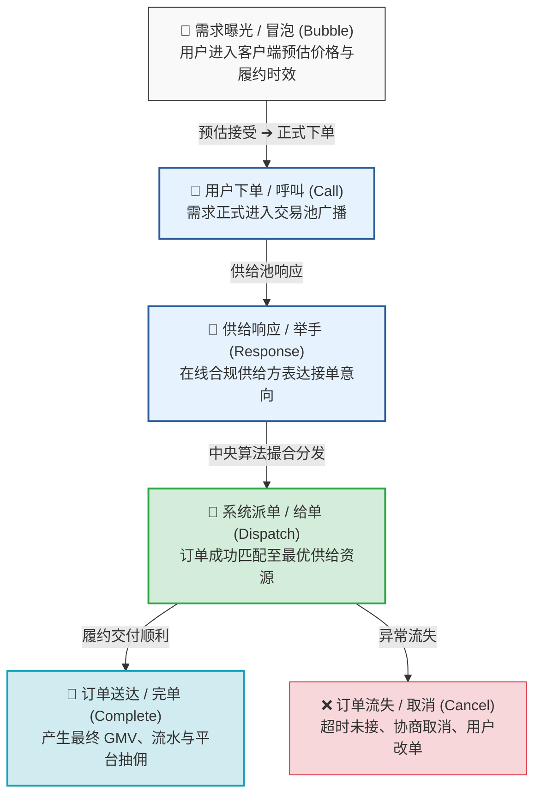
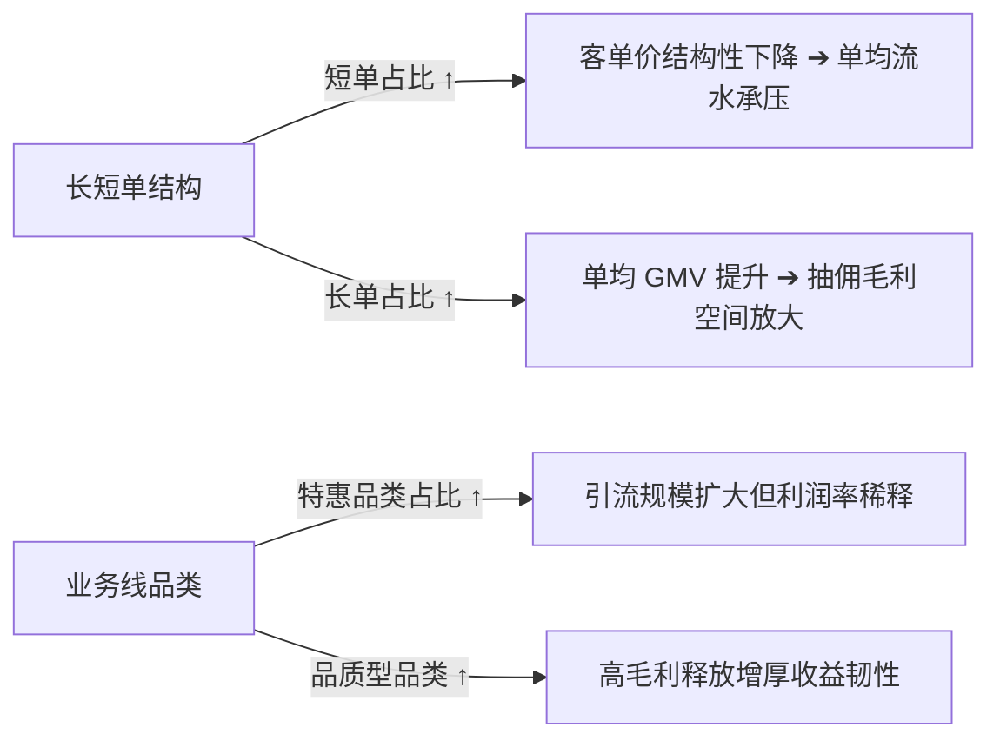

# 交易中台经营分析技能 (Transaction Operations Skill)

<p align="center">
  <strong>基于双边交易履约全链路漏斗的交易中台周度经营分析与归因分析技能框架</strong>
</p>

<p align="center">
  <a href="https://github.com/zhangpelf/transaction-ops-skill"></a>
  <a href="https://github.com/zhangpelf/transaction-ops-skill/blob/main/LICENSE"></a>
  <a href="https://github.com/zhangpelf/transaction-ops-skill"></a>
  <a href="https://github.com/zhangpelf/transaction-ops-skill"></a>
</p>

---

## 📌 项目定位与背景

在双边市场与即时履约领域，**交易中台（Transaction Mid-Platform）** 是连接上游多渠道流量入口、下游供给资源池与中央算法定价调度的核心中枢。

面对复杂的实时交易流与多渠道（自营渠道、多方聚合分发渠道）、多品类（基础型、特惠型、品质型、聚合优选型）的撮合网络，运营分析人员需要每周复盘核心业务问题：
1. **漏斗在哪个环节断流？** 是用户预估后不发单（冒发率低），还是供给端不响应（举手率低），抑或是撮合算法派发失败（给单率低）？
2. **大盘是在“缺供态”还是“缺需态”？** 节点周期、外部环境波动或高峰平峰切换时，供需天平如何倾斜？
3. **单量增长，为何综合毛利率反向承压？** 特惠品类占比上升、短单比例漂移如何结构性影响平台客单价与毛利？

**`transaction-ops-skill`** 提炼自交易中台全链路运营分析与供需撮合方法论，旨在沉淀一套**纯方法论驱动、指标体系完备、完全去私有化**的标准化作业指南（SOP）与报告模板，供交易平台数据分析师、策略运营专家及 AI Agent 使用。

> 🛡️ **严格脱敏与无数据声明**：  
> 本开源项目**不包含任何特定企业的真实业务数据、内部指标数值、具体金额与比例阈值、专有数据库表名、系统接口、组织架构或个人信息**。所有分析案例、指标样例及模板表格均采用通用结构与占位符，仅展示通用的漏斗转化机制、指标推导算子与归因分析模型。

---

## 🔄 订单全链路生命周期转化漏斗 (Funnel Model)

实时交易撮合与履约流转遵循以下五步核心状态演化：



---

## 📊 核心指标体系与业务意义

| 漏斗阶段 | 核心指标 | 计算公式 | 业务含义与调优抓手 |
| :--- | :--- | :--- | :--- |
| **冒泡 $\to$ 呼叫** | **冒发率** | $\frac{\text{呼叫数}}{\text{冒泡数}}$ | **发单意愿转化**。受预估定价、预估等待履约时长及动态调价倍率影响。 |
| **呼叫 $\to$ 举手** | **举手率** | $\frac{\text{举手数}}{\text{呼叫数}}$ | **供给响应充裕度**。核心反映供给端对当前订单价值、履约难度的接受度及在线密度。 |
| **举手 $\to$ 给单** | **给单率** | $\frac{\text{给单数}}{\text{举手数}}$ | **撮合调度成功率**。反映派单引擎的时空匹配效率、多平台抢单竞争格局。 |
| **给单 $\to$ 完单** | **完单率** | $\frac{\text{完单数}}{\text{给单数}}$ | **真实交付兑现率**。反映服务履约质量与交付履约履约稳定性。 |
| **异常流失** | **取消率** | $\frac{\text{取消数}}{\text{给单数}}$ | **经营磨损预警**。取消率过高通常指向长距离匹配或供给端协商跳单行为。 |
| **经营补贴** | **补贴率** | $\frac{\text{营销补贴额}}{\text{平台流水 GMV}}$ | **补贴健康度**。衡量单位产值消耗的让利成本，防范非理性价格战。 |

---

## 📈 供需状态辨识与双动因归因分析模型

### 1. 供需天平双稳态判别

交易中台的核心职责是实时感知市场由“缺供态”向“缺需态”或反方向的周期性迁移：

```
                      【供需状态迁移雷达】
          
              缺供态 (Supply-Constrained)
            ▲ • 举手率走高，供给端响应意愿强
            │ • 撮合给单率高，完单率稳定
            │ • 短单频次激增，溢价空间大
  ──────────┼──────────────────────────────►
            │ • 举手率走低，接单意愿疲软
            │ • 给单率承压，长单占比漂移
            ▼ • 客单价回落，平台沉淀闲置供给
              缺需态 (Demand-Constrained)
```

- **缺供态策略**：开启高峰激励、调度引导外围供给回流核心热点区域、合理调高平峰转高峰阶梯定价；
- **缺需态策略**：启动需求端促发、与多方聚合平台联动放大公域流量导入、加大特惠品类投放激活长尾转化需求。

---

## 2. 营收-利润双动因归因框架 (Revenue-Profit Attribution)

大盘毛利的变化，由以下两项底层结构性位移驱动：

$$\Delta \text{平台营收与毛利} = f(\text{长短单结构效应}) + f(\text{业务线品类效应}) + \epsilon$$



1. **订单标的结构效应（长短单）**：
   - **短单**：高频、抗周期，但客单价低。若短单伴随固定起步补贴，易形成单均亏损；
   - **长单**：单均流水高、抽佣利润充沛。长单占比下滑将拉低综合客单价。
2. **产品线定位差异效应**：
   - **基础型**（基本盘，利润率基准稳定）；
   - **特惠型**（平谷期填补闲置供给，低毛利引流品）；
   - **品质型**（高端商务，高客单、高利润贡献品）。

---

## 📋 标准周度分析报告架构

技能输出走固定五段式标准交付格式：

```
一、 大盘供需态势变化（定性先行：供需状态识别与宏观拐点）
二、 核心异动与风险预警（大区/渠道维度的关键掉队环节定位）
三、 漏斗关键指标拆解（举手率、给单率、取消率、完单量、客单价、利润率）
四、 关键指标汇总矩阵（多渠道横向对比、多维汇总表）
五、 营收-利润影响归因与策略建议（长短单结构测算、业务线健康度星级、行动落地建议）
```

详见报告纯净模板：[`templates/weekly_analysis_template.md`](templates/weekly_analysis_template.md)。

---

## 📂 仓库目录导航

```
transaction-ops-skill/
├── SKILL.md                          # 核心技能规范（Agent 提示词与分析逻辑定义）
├── README.md                         # 技能全景介绍主文档（脱敏无数据版）
├── docs/                             # 深度业务手册
│   ├── METRIC_DICTIONARY.md          # 交易中台全量指标字典与算子公式
│   └── OPERATIONAL_PLAYBOOK.md       # 常见供需异动排查与调度调控 SOP
├── templates/                        # 报告与表格模板
│   └── weekly_analysis_template.md   # 脱敏版周度经营分析报告标准模板
└── LICENSE                           # MIT 开源许可证
```

---

## 📖 深度文档

- [指标标准字典与算式规范 (docs/METRIC_DICTIONARY.md)](docs/METRIC_DICTIONARY.md)
- [经营异动排查与调度运营 SOP (docs/OPERATIONAL_PLAYBOOK.md)](docs/OPERATIONAL_PLAYBOOK.md)
- [周度分析报告纯净模板 (templates/weekly_analysis_template.md)](templates/weekly_analysis_template.md)

---

## 📄 License

本项目采用 [MIT 许可证](LICENSE)。自由用于平台交易数字化运营、商业智能（BI）分析及大模型 Agent 技能开发。
