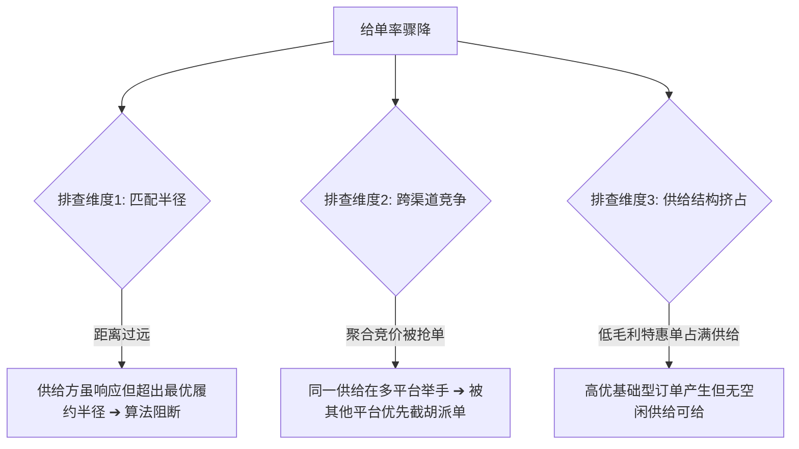

# 交易中台经营异动排查与运营手册 (OPERATIONAL_PLAYBOOK)

> 本手册汇编交易中台在周度监测中常见的各类典型经营异动，
> 提供标准化的下钻归因步骤（Troubleshooting SOP）及对应的策略调控工具。

---

## 异常一：举手率正常，但给单率骤降

### 1. 现象定义
在线供给端响应呼叫意愿良好（举手率处于基准线以上），但撮合给单率环比出现大幅下滑。

### 2. 根因排查链路

### 3. 运营与策略调控动作
- **时空调度微调**：收紧非高峰期最大派单匹配半径阈值，避免无效远距离响应；
- **聚合平台竞价策略优化**：核查在聚合平台的派单响应延迟与出价评分，提升高潜大区的抢单命中率；
- **品类配额保护**：在供给紧张时段，限制低毛利特惠品类派单比例，为高利润业务线保留缓冲供给池。

---

## 异常二：特惠单单量爆发，但大盘综合毛利受损（“增量不增利”）

### 1. 现象定义
周度完单量显著上扬，但综合利润率环比回落，整体财务收益未达预期。

### 2. 根因归因模型
特惠型订单具有单均流水较低、利润率偏薄的天然属性。
当满足以下条件时，会触发负向反噬效应：
$$\text{特惠单边际利润} < \text{被挤占的常规订单损失利润} + \text{平台额外补助力度}$$

### 3. 调优策略
- **分时段动态开关**：将特惠品类限制在平峰与低谷期，早晚高峰适度限制特惠品类分流权重；
- **基础定价与短单补贴退坡**：针对超短履约订单，优化补贴结构，促使供给向中长程订单迁移。

---

## 异常三：撮合后取消率异动飙升（突破警戒线）

### 1. 现象定义
系统撮合派单成功后，取消率异常走高，不仅产生空置调度损耗，更极大伤害用户留存。

### 2. 下钻分析四象限
1. **用户端主动取消（按时段下钻）**：
   - *派单初期取消*：用户跨多平台比价，其他平台先完成响应匹配；
   - *等待较长时间后取消*：供给方长时间无位移推进、外部交通严重拥堵或路线严重偏航。
2. **供给端主动取消**：
   - *供给方协商取消*：标的偏小供给嫌单小，或目的地偏远返程无单；
   - *无责取消*：用户起始位置设置错误或联系不上。

### 3. 应对治理
- **引入履约等待保障机制**：预估履约超时自动发放补偿优惠权益；
- **供给方反向挑单行为惩戒**：对高频诱导用户取消或派单后长时间无推进的供给实施高峰派单降权；
- **远程返程派单优化**：针对目的地为偏远区域的长单，给供给方提供返程优先匹配权益，降低拒单与取消冲动。

---

## 异常四：供需状态时空迁移不同步（淡旺季/恶劣天气）

### 1. 现象特征
节假日前后或突发恶劣天气，市场在短时间内由“缺需态”快速转化为“极度缺供态”，若策略切换滞后，会导致短时间内大量订单因无供给响应而超时流失。

### 2. 敏捷切换 SOP
- **外部环境联动预警**：提前预设恶劣天气与节假日应急调度模板；
- **阶梯式供给激励**：启动高峰上线奖励与冲单激励，提升在网活跃供给基数；
- **聚合引流与组合调度**：在极度缺供区域引导用户开启多品类同时呼叫，提升单位供给资源的履约承载效率。
